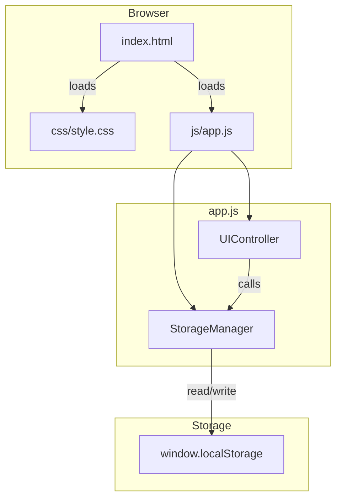
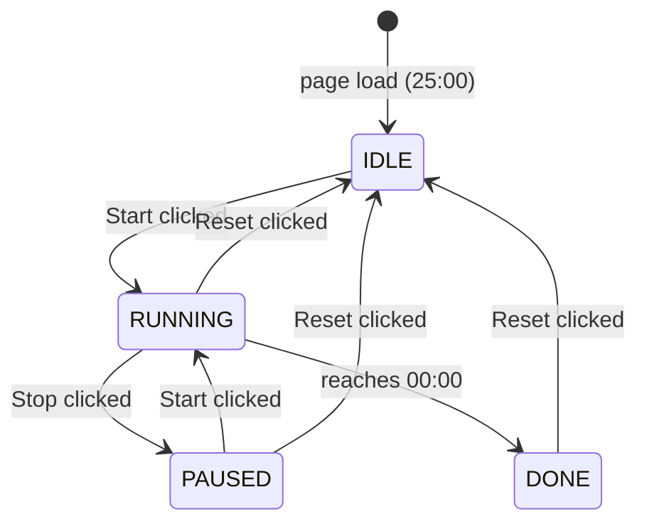

# Design Document

## Overview

The TODO List Dashboard is a zero-dependency, single-page web application delivered as three files: `index.html`, `css/style.css`, and `js/app.js`. It runs entirely in the browser with no build step, no transpiler, and no framework. Four widgets share one screen: a live greeting clock, a Pomodoro focus timer, a persistent to-do list, and a customizable quick-links panel. All mutable state is kept in memory and mirrored to `window.localStorage` through a thin Storage Manager module. The UI Controller module owns all DOM interaction and delegates data operations to Storage Manager.

The design prioritises:
- **Simplicity** — every feature maps to a function; no class hierarchies.
- **Correctness** — all user-facing state changes are validated before they touch storage.
- **Resilience** — `localStorage` failures degrade gracefully without breaking the session.

---

## Architecture

The application is split into two logical modules within a single `app.js` file, using the Module Pattern (immediately-invoked objects / closures) to avoid polluting the global scope.



**Startup sequence:**

1. `DOMContentLoaded` fires.
2. `UIController.init()` is called.
3. `UIController.init()` calls `StorageManager.load()` to read tasks and links.
4. Each widget is rendered with the loaded data.
5. The clock interval starts; the timer is initialised to 25:00.

**Module responsibilities:**

| Module | Responsibility |
|--------|---------------|
| `StorageManager` | JSON serialise/deserialise, read/write `localStorage`, error handling for unavailable storage |
| `UIController` | DOM rendering, event listeners, widget state machines (timer), validation messages |

No shared mutable variables exist between the two modules. `UIController` holds all runtime widget state (timer interval handle, current task array, current links array) in closures.

---

## Components and Interfaces

### StorageManager

```js
StorageManager = {
  isAvailable(): boolean,           // tests window.localStorage write/read
  load(key): any[],                 // reads + JSON.parses; returns [] on any error
  save(key, data): void,            // JSON.stringifies + writes; swallows errors, sets unavailableFlag
}
```

**Keys:**
- `'todo-dashboard-tasks'` — array of Task objects
- `'todo-dashboard-links'` — array of Link objects

**Error policy:** If `localStorage.setItem` throws (quota exceeded, private browsing), `StorageManager` sets an internal `unavailableFlag` and the UI banner is shown once.

---

### UIController

Sub-components and their DOM anchors:

| Sub-component | DOM id | Description |
|---------------|--------|-------------|
| GreetingWidget | `#greeting` | Clock, date, greeting message |
| TimerWidget | `#timer` | Countdown display, Start/Stop/Reset buttons |
| TaskListWidget | `#task-list` | Task add form, task items |
| QuickLinksWidget | `#quick-links` | Link add form, link buttons |
| BannerWidget | `#storage-banner` | Non-blocking localStorage warning |

Each sub-component exposes an `init()` function and an internal `render()` function. `render()` is a pure DOM replacement — it rebuilds the widget's inner HTML from the current in-memory array.

**Inter-widget communication:** None. Widgets are independent. The timer completion triggers an `<audio>` element and a CSS class on the timer display; it does not affect other widgets.

---

### GreetingWidget

```
init()        → starts setInterval(tick, 1000)
tick()        → reads Date(), formats time/date/greeting, updates DOM
getGreeting(hour: number): string
              → 5–11  → "Good Morning"
              → 12–17 → "Good Afternoon"
              → else  → "Good Evening"
formatTime(d: Date): string   → "HH:MM:SS"
formatDate(d: Date): string   → "WEEKDAY, DD MONTH YYYY"
```

If `new Date()` throws or returns an invalid date, the widget displays `"Time unavailable"` in all three fields.

---

### TimerWidget

State machine:



| State | Start btn | Stop btn | Reset btn |
|-------|-----------|----------|-----------|
| IDLE | enabled | disabled | enabled |
| RUNNING | disabled | enabled | enabled |
| PAUSED | enabled | disabled | enabled |
| DONE | disabled | disabled | enabled |

The countdown uses `setInterval(tick, 1000)`. On state transition, the previous interval is always cleared before a new one is set, preventing duplicate intervals.

Completion fires:
1. CSS class `timer--done` on the display element (non-dismissible visual indicator).
2. `HTMLAudioElement.play()` on a short beep embedded as a base64 data-URI.

---

### TaskListWidget

```
init(tasks: Task[])        → stores tasks array, renders
addTask(title: string)     → validates, creates Task, saves, renders
toggleTask(id: string)     → flips completion, saves, renders
beginEdit(id: string)      → replaces title span with <input>
confirmEdit(id, value)     → validates, updates title, saves, renders
cancelEdit(id)             → restores read-only display
deleteTask(id: string)     → removes from array, saves, renders
render()                   → full DOM rebuild of task list
```

Validation rules:
- `addTask`: title after `trim()` must be non-empty.
- `confirmEdit`: value after `trim()` must be non-empty; if empty, discard and restore.

---

### QuickLinksWidget

```
init(links: Link[])               → stores links array, renders
addLink(label, url)               → validates, creates Link, saves, renders
deleteLink(id: string)            → removes, saves, renders
render()                          → full DOM rebuild of link buttons
```

Validation rules (all checked before any storage write):
- `label.trim()` length ∈ [1, 50].
- `url.trim()` length ∈ [1, 2048].
- `url` starts with `http://` or `https://`.
- Total links count < 20.

Each link button has `target="_blank"` and `rel="noopener noreferrer"`.

---

## Data Models

### Task

```js
{
  id: string,          // crypto.randomUUID() or Date.now().toString() fallback
  title: string,       // trimmed, non-empty, user-provided
  completed: boolean,  // false on creation
  createdAt: number    // Date.now() (Unix ms)
}
```

Stored as a JSON array under key `'todo-dashboard-tasks'`. Tasks are always rendered ordered by `createdAt` ascending.

### Link

```js
{
  id: string,          // crypto.randomUUID() or Date.now().toString() fallback
  label: string,       // 1–50 characters, trimmed
  url: string          // 1–2048 characters, trimmed, http(s) prefix required
}
```

Stored as a JSON array under key `'todo-dashboard-links'`. Maximum 20 entries.

### StorageManager internal state

```js
{
  unavailableFlag: boolean   // set true on first write failure; triggers banner once
}
```

No other shared state. Widget arrays live exclusively in `UIController` closures.

---

## Correctness Properties

*A property is a characteristic or behavior that should hold true across all valid executions of a system — essentially, a formal statement about what the system should do. Properties serve as the bridge between human-readable specifications and machine-verifiable correctness guarantees.*

### Property 1: JSON serialization round-trip

*For any* array of Task objects or Link objects with valid fields, serializing to JSON and then deserializing must produce an array structurally equal to the original.

**Validates: Requirements 5.2, 5.3**

---

### Property 2: Empty/whitespace task titles are always rejected

*For any* string composed entirely of whitespace characters (including the empty string), calling `addTask` with that string must leave the task list unchanged and must not write to LocalStorage.

**Validates: Requirements 3.2**

---

### Property 3: Valid task addition grows the list by one

*For any* existing task list and any non-whitespace task title, calling `addTask` must increase the task list length by exactly one and the new task must appear at the end (highest `createdAt`).

**Validates: Requirements 3.1**

---

### Property 4: Task deletion removes exactly one entry

*For any* task list containing a task with a given id, calling `deleteTask(id)` must produce a list whose length is exactly one less than before, and that id must not appear in the resulting list.

**Validates: Requirements 3.11**

---

### Property 5: Toggle completion is an involution

*For any* task, calling `toggleTask` twice in succession must return the task to its original completion state.

**Validates: Requirements 3.5**

---

### Property 6: Empty/whitespace edit is discarded

*For any* task with a non-empty title, calling `confirmEdit` with an empty or whitespace-only value must leave the task's title and the storage unchanged.

**Validates: Requirements 3.9**

---

### Property 7: Valid link addition is bounded at 20

*For any* links list with fewer than 20 entries and a valid label/URL pair, calling `addLink` must increase the list by one. *For any* links list with exactly 20 entries, calling `addLink` must leave the list unchanged.

**Validates: Requirements 4.1, 4.5**

---

### Property 8: URL protocol validation

*For any* URL string that does not begin with `http://` or `https://`, calling `addLink` must reject the submission and leave the links list unchanged.

**Validates: Requirements 4.3**

---

### Property 9: Greeting function covers all hours

*For any* integer hour in [0, 23], `getGreeting(hour)` must return exactly one of "Good Morning", "Good Afternoon", or "Good Evening", with no hour returning an empty or unexpected string.

**Validates: Requirements 1.3, 1.4, 1.5**

---

### Property 10: StorageManager returns empty array on bad data

*For any* value stored in a LocalStorage key that is either absent, not valid JSON, or a valid JSON non-array, `StorageManager.load(key)` must return `[]`.

**Validates: Requirements 5.3**

---

## Error Handling

| Scenario | Detection | Response |
|----------|-----------|----------|
| `localStorage` unavailable | `StorageManager.isAvailable()` on startup | Show `#storage-banner`; all operations continue in-memory |
| `localStorage` write failure | `try/catch` around `setItem` | Set `unavailableFlag`, show banner if not already shown |
| Invalid JSON in storage | `try/catch` around `JSON.parse` | Return `[]`, widget renders empty list |
| `new Date()` returns invalid date | `isNaN(d.getTime())` check | Display `"Time unavailable"` in all greeting fields |
| Timer interval drift | N/A for 25-min session | Acceptable; `setInterval(1000)` accuracy is sufficient for a Pomodoro timer |
| `crypto.randomUUID` absent | `typeof crypto.randomUUID !== 'function'` | Fall back to `Date.now().toString() + Math.random()` |
| Link URL missing protocol | String `.startsWith` check | Show inline validation message; do not create link |
| Task/link field length violations | Length checks before creation | Show inline validation message adjacent to offending field |

All validation errors are shown inline, adjacent to the relevant field. No global error alerts. Errors are cleared on the next successful submission attempt.

---

## Testing Strategy

### Unit Tests (example-based)

Each pure function is tested with concrete examples:

- `getGreeting(hour)` — test boundary hours: 0, 4, 5, 11, 12, 17, 18, 23.
- `formatTime(date)` — test single-digit padding: `"03:07:09"`.
- `formatDate(date)` — test known date: `new Date(2026, 10, 19)` → `"Thursday, 19 November 2026"`.
- `StorageManager.load(key)` — test absent key, non-JSON value, JSON object (not array), valid array.
- Timer state transitions — test each valid transition and confirm invalid transitions are ignored.
- Validation logic — empty string, whitespace string, oversized label, URL without protocol, 21st link.

### Property-Based Tests

Property-based testing is applicable here because the core logic (storage serialization, task/link validation, greeting function, task list mutations) consists of pure functions over structured data. The input space is large and varied enough that randomized inputs find edge cases that example tests miss.

**Library:** [fast-check](https://fast-check.dev/) (JavaScript, runs in Node without a bundler via `npx`).

**Minimum iterations:** 100 per property.

**Tag format:** Each test is tagged with a comment:
`// Feature: todo-dashboard, Property N: <property_text>`

| Property | Test description |
|----------|-----------------|
| Property 1 | Generate random Task/Link arrays; serialize then deserialize; assert deep equality |
| Property 2 | Generate whitespace-only strings; call `addTask`; assert list unchanged, no storage write |
| Property 3 | Generate task list + non-empty title; call `addTask`; assert length +1, new entry at end |
| Property 4 | Generate task list with ≥1 task; pick random id; call `deleteTask`; assert length -1, id absent |
| Property 5 | Generate any task; `toggleTask` twice; assert completion state unchanged |
| Property 6 | Generate task + whitespace string; `confirmEdit`; assert title and storage unchanged |
| Property 7 | Generate lists of size 0–19 + valid link → assert length +1; size 20 + valid link → assert unchanged |
| Property 8 | Generate URLs without `http://` or `https://` prefix; `addLink`; assert list unchanged |
| Property 9 | Generate integer in [0, 23]; `getGreeting`; assert result ∈ {"Good Morning", "Good Afternoon", "Good Evening"} |
| Property 10 | Generate absent/invalid/non-array storage values; `load`; assert result is `[]` |

### Integration / Smoke Tests

These are run manually in each target browser (Chrome, Firefox, Edge, Safari):

- Page loads and all four widgets render within 2 seconds.
- Clock ticks every second; greeting changes at hour boundaries.
- Timer counts down, disables Start while running, plays alert at 00:00.
- Task add/complete/edit/delete persists across page reload.
- Link add/open/delete persists across page reload.
- Private browsing mode shows storage banner, all operations work in-memory.
- Viewport at 360 px and 2560 px — no horizontal scroll.
- All controls reachable via keyboard Tab; focus indicator visible.
